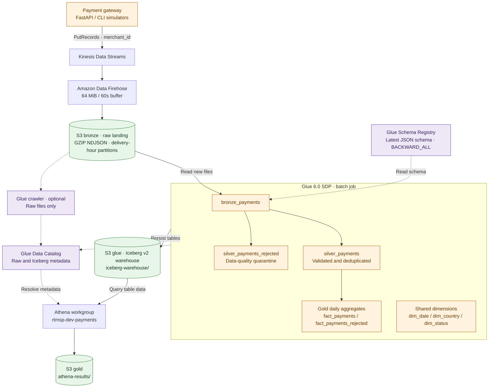
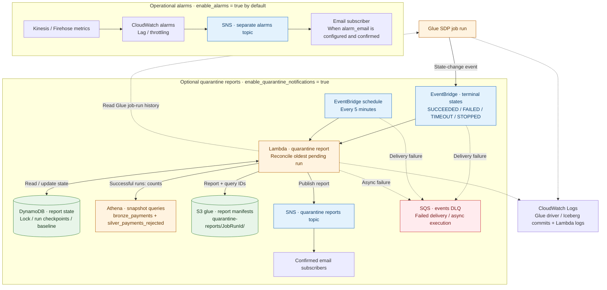
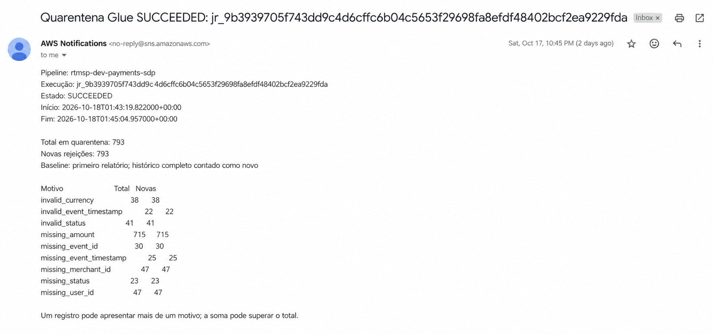

# Payment Data Platform

A batch payments data platform on AWS. The project simulates a payment source, stores raw events in S3, and transforms them into analytical tables that can be queried with Athena.

## Purpose

This project demonstrates a payments data flow from ingestion to analysis:

- publish typed payment events;
- preserve raw data for auditing and replay;
- validate and deduplicate records, and quarantine invalid data;
- produce daily aggregates and dimensions for Athena analysis.

This is a **batch** platform, not a real-time event processor. Kinesis receives events; Firehose delivers them to S3 as files; Glue processes those files when its job runs. The platform has one payment source.

## Architecture

### Data flow



Solid arrows show data movement; dotted arrows show schema and catalog dependencies.
The crawler is optional for raw Athena queries; SDP reads S3 directly. All SDP
layers persist in the **glue bucket's Iceberg warehouse**.
`fact_payments_rejected` aggregates failed payment statuses;
`silver_payments_rejected` contains data-quality failures.

### Job-run reports and operational monitoring



DynamoDB tracks report processing, not payment records. SQS is a failure
queue; it is not on the normal report-delivery path. The Lambda queries Iceberg
snapshots through the same Athena workgroup, with results in
`s3://{gold}/athena-results/`. Failed Glue runs produce diagnostic reports with
counts unavailable. SNS publication and DynamoDB checkpointing are not atomic,
so a retry can duplicate an email.

These diagrams describe repository configuration, not verified AWS deployment.
Quarantine reporting is opt-in; its SNS topic is separate from operational alarms.

To receive these emails, set `enable_quarantine_notifications = true` and add at least one address to `quarantine_notification_emails` in `infra/terraform/terraform.tfvars` before applying Terraform. Attach the [quarantine deployment policy](docs/iam-deploy-quarantine-policy.json) and confirm each SNS email subscription. For each terminal Glue job run, the report includes the run status and times. Successful runs also report total and newly rejected rows, with counts by rejection reason. The first report counts existing history as new; one row may have multiple rejection reasons.



Terraform provisions ingestion, storage, Glue, Athena, IAM, and the optional reporting and alarm resources shown above. The SDP job creates and refreshes the Iceberg tables, reading the latest Registry contract to define the bronze schema.

| Stage | Service or output | Purpose |
|---|---|---|
| Production | FastAPI or CLI simulator | Generates events and publishes them to Kinesis in batches, using `merchant_id` as the partition key |
| Ingestion | Kinesis Data Streams | Receives payment events |
| Delivery | Kinesis Data Firehose | Writes GZIP NDJSON to S3 bronze; default buffer is 64 MiB or 60 seconds |
| Optional catalog | Glue crawler | Catalogs only raw files under `payments/raw/`; the SDP does not require it |
| Transformation | Glue 6.0 Spark Declarative Pipelines | Reads bronze with the Registry schema and writes Iceberg v2 tables |
| Query | Athena | Queries Iceberg tables in the `rtmsp-dev-payments` workgroup |

The SDP produces:

- `bronze_payments`: ingested events;
- `silver_payments`: valid, typed events deduplicated by `(event_id, merchant_id)`;
- `silver_payments_rejected`: invalid records with all applicable rejection reasons;
- `fact_payments` and `fact_payments_rejected`: daily aggregates by date, merchant, status, country, and currency;
- `dim_date`, `dim_country`, and `dim_status`: shared dimensions.

Bronze files are stored under `s3://{bronze}/payments/raw/`, partitioned by delivery hour. Pipeline artifacts and state are stored under `s3://{glue}/glue/pipelines/payments/`; the Iceberg warehouse is `s3://{glue}/iceberg-warehouse/`. Athena query results use `s3://{gold}/athena-results/`. Find the actual bucket names in the Terraform `medallion_buckets` output. Logical silver and gold layers do not mean their tables are stored in buckets with those names.

### Monetary contract

The current producer serializes `amount` as an exact JSON number in `currency`, with no currency conversion. The project allows up to 18 digits and two decimal places for all supported currencies. Silver prefers `amount` and reads `amount_usd` only as a legacy historical alias. GMV includes only `captured` payments; preserve currency when comparing or summing amounts. See [docs/architecture.md](docs/architecture.md) for the full validation, deduplication, dimension, reporting, and operational rules.

## Prerequisites

- Python 3.10+ and [uv](https://docs.astral.sh/uv/).
- Docker. On Windows, use WSL to run `infra/tf.sh`.
- AWS credentials for a deployment identity configured with the IAM policies below.
- Local AWS files at `.aws/config` and `.aws/credentials` (Git-ignored), and a root `.env` file. Never commit credentials or Terraform state.

### Deployment IAM policies

Before deploying the complete stack, an IAM administrator must create **three separate customer managed IAM policies** from these repository templates. Replace `ACCOUNT_ID` with the deployment account's 12-digit ID in each file before creating the policies, then attach them to the deployment identity:

| Policy template | When to attach |
|---|---|
| [Core deployment policy](docs/iam-deploy-policy.json) | Always |
| [Alarms policy](docs/iam-deploy-alarms-policy.json) | When `enable_alarms = true` (the default) |
| [Quarantine reports policy](docs/iam-deploy-quarantine-policy.json) | When `enable_quarantine_notifications = true` |

Attach all three when both optional features are enabled. These policies are an IAM bootstrap step; Terraform does not create or attach them to the deployment identity. For installation and permission scope, see [docs/iam-deploy.md](docs/iam-deploy.md).

Example `.aws/config`:

```ini
[default]
region = us-east-1
output = json
```

Example `.aws/credentials`:

```ini
[default]
aws_access_key_id = <key>
aws_secret_access_key = <secret>
```

For temporary credentials, add `aws_session_token` under `[default]`. Create `.env` from the example:

```bash
cp .env.example .env
```

At minimum, set `AWS_ACCESS_KEY_ID`, `AWS_SECRET_ACCESS_KEY` and, if needed, `KINESIS_STREAM_NAME`. The example defaults to `rtmsp-dev-payments-events`. The default region is `us-east-1`; `KINESIS_BATCH_SIZE`, `KINESIS_MAX_RETRIES`, and `LOG_LEVEL` are optional.

## Start the services and run the pipeline

The terminal examples use Bash. On Windows, run them in WSL; WSL is also required for `infra/tf.sh`.

### 1. Prepare and deploy AWS infrastructure

The Docker `terraform` service provides Terraform 1.15.8 and the AWS CLI inside a container. Use the script below on the host; you do not need to install Terraform or the AWS CLI locally.

```bash
./infra/tf.sh up
./infra/tf.sh shell
```

Inside the container shell:

```bash
terraform init
terraform plan -out=tfplan
terraform show tfplan
terraform apply tfplan
terraform output
```

Review the saved plan before applying it. If `infra/terraform/terraform.tfvars` is missing, `tf.sh up` creates it from `terraform.tfvars.example`; edit this Git-ignored file to customize variables. Useful outputs include `kinesis_stream_name`, `medallion_buckets`, `glue_database_name`, `glue_crawler_name`, `glue_payments_sdp_job`, `glue_schema_registry`, and `athena_workgroup`.

When finished with the workspace, exit the shell and run `./infra/tf.sh down`. This stops the local container; it does not destroy the AWS stack. To remove the stack, review a `terraform destroy` plan inside the container and consider the data in S3 buckets before applying it.

### 2. Install application dependencies

From the repository root:

```bash
uv sync --group dev
```

### 3. Start the FastAPI service (optional)

The API generates events; it does not accept arbitrary payment payloads. It provides `/health`, OpenAPI documentation at `/docs`, and `POST /payments/events/generate`. Start it in a terminal:

```bash
PYTHONPATH=src uv run --no-sync uvicorn payments_gateway.api:app --reload --reload-dir src/payments_gateway --port 8080
```

Check the health endpoint and generate 100 valid events from another terminal:

```bash
curl http://127.0.0.1:8080/health
curl -X POST http://127.0.0.1:8080/payments/events/generate \
  -H 'Content-Type: application/json' \
  -d '{"count":100}'
```

The request body controls event generation. To include about 20% invalid events and 30% events with timestamps two days in the past:

```bash
curl -X POST http://127.0.0.1:8080/payments/events/generate \
  -H 'Content-Type: application/json' \
  -d '{"count":100,"bad_ratio":0.2,"late_ratio":0.3,"late_seconds":172800,"scenario":"invalid-amount"}'
```

The ratios are independent probabilities, so actual counts vary and the selections may overlap. Omit `scenario` to cycle through fault types.

### 4. Start the CLI simulator (alternative to the API)

With `.env` configured, publish valid events to `KINESIS_STREAM_NAME`:

```bash
uv run payments-simulator --rate 10 --duration 30
```

This attempts to generate ten events per second for 30 seconds. To cap the run by event count:

```bash
uv run payments-simulator --rate 10 --count 500
```

Use the API **or** the CLI simulator to generate the events you need; both publish to the same stream.

### 5. (Optional) Generate invalid and late events

The chaos simulator is another optional producer. It uses the existing stream, injects payload faults, and can simulate late arrivals. To preview NDJSON locally without credentials or AWS calls:

```bash
uv run payments-chaos-simulator --dry-run --count 100
```

To publish 500 attempts, with about 40% invalid events and 30% of event timestamps two days in the past:

```bash
uv run payments-chaos-simulator --count 500 --rate 10 \
  --bad-ratio 0.4 --late-ratio 0.3 --late-seconds 172800
```

`--late-seconds` changes the event timestamp; it does not delay execution. Firehose files remain partitioned by delivery time. See [AGENTS.md](AGENTS.md) for the full list of scenarios.

### 6. Catalog and process the data

Firehose delivers files after its buffer reaches 64 MiB or 60 seconds. To query raw files directly in Athena, run the optional crawler from the Terraform container shell:

```bash
aws glue start-crawler --name rtmsp-dev-payments-bronze-raw
```

The crawler covers bronze only and is not required for the SDP to read the files. Start the Glue job to transform bronze into silver, quarantine, and gold:

```bash
aws glue start-job-run --job-name rtmsp-dev-payments-sdp
```

Run these AWS commands inside the container, started with `./infra/tf.sh up` and accessed with `./infra/tf.sh shell`. Bronze uses a checkpoint to read new files; silver and gold are refreshed by the job. A normal run does not replay files already recorded in the checkpoint.

### 7. Query the data in Athena

Open the `rtmsp-dev-payments` workgroup in Athena and query the database created by Terraform. Reference queries are in [docs/demo-queries.md](docs/demo-queries.md). The SQL in `sql/athena/gold/` contains a legacy dimensional design (`fact_payment`, singular); the current SDP outputs are `fact_payments`, `fact_payments_rejected`, and the three dimensions listed above.

For GMV, filter on `status = 'captured'` and group or compare by `currency`. `fact_payments` also contains authorized and refunded payments.

## Local tests and quality checks

```bash
uv run pytest -q
uv run ruff check src tests pipelines
uv run black --check src tests pipelines
```

Spark tests require Python 3.11, Java 17, and PySpark 4.1.1:

```bash
uv run --group dev --with pyspark==4.1.1 python -m pytest -q
```

Local tests do not access AWS. They validate Spark transformations and replace only SDP registration. Local execution does not confirm Glue execution-graph compatibility or deployed AWS state. CI also runs Terraform fmt and validate.

## Costs and limitations

Kinesis, Firehose, Glue, S3, and Athena queries can incur AWS charges. Editing or deploying repository code does not automatically run the crawler or job. For IAM, alarms, Iceberg snapshots, and quarantine-report operations, see [docs/architecture.md](docs/architecture.md) and [docs/iam-deploy.md](docs/iam-deploy.md).

## License

[MIT](LICENSE)
